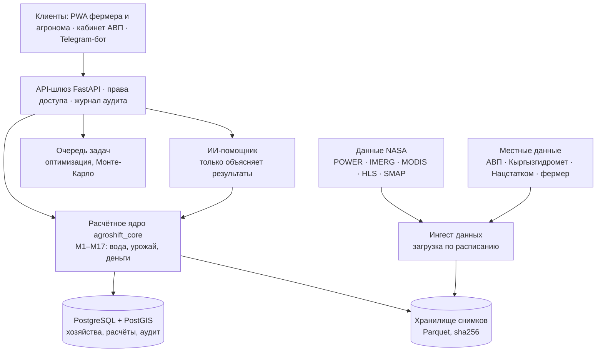

# Архитектура AgroShift

Все числа считает расчётное ядро, ИИ только объясняет (раздел 11 ТЗ).



## Слои и папки

| Слой | Папка | Состояние |
|---|---|---|
| Клиенты | `frontend/` | пусто |
| API-шлюз | `backend/app/` | каркас, эндпоинты-заглушки |
| Расчётное ядро | `backend/agroshift_core/` | пустые модули М1–М17 |
| ИИ-помощник | `backend/app/ai/` | пусто |
| Очередь задач | — | на хакатоне не нужна: один процесс FastAPI |
| БД | `backend/app/models/`, `backend/alembic/` | схема готова (раздел 7.1) |
| Хранилище снимков | `backend/data/snapshots/` | локальная папка; MinIO — в пилоте |
| Ингест | `backend/ingest/` | пусто |

## Поток расчёта

```
Снимок NASA POWER (Parquet) ─► М1 климат ─► М2 ET0 ─► М3 ETc ─► М4 водный баланс
                                                              ▲
             Подача канала, очередь (М5) ─────────────────────┘
М4 ─► М6 урожай ─► М8 корма ─► М9 деньги по месяцам
Всё выше × N выборок (М10) ─► P10/P50/P90 ─► Run + RunMetric в БД
Стратегии (М11) → стресс-тест (М12) → точка поломки (М13) → EVPI (М14) → сравнение (М17)
```

Run неизменяем: (стратегия, сценарий, снимки, версия модели, seed) → всегда один результат.

## Упрощения для хакатона (раздел 14.1)

| Полная версия | На хакатоне |
|---|---|
| MILP-оптимизатор (М11) | перебор утверждённых севооборотов (≤ 500 комбинаций) |
| Монте-Карло 500 выборок | 30 исторических лет NASA + ценовой шум |
| Сад на 25 лет (М7) | «оставить / выкорчевать 1 га» на 5 лет |
| План канала MILP (М15) | жадный сдвиг сроков сева, 20 синтетических хозяйств |
| Аутентификация, роли, RLS | демо-режим, переключатель «Фермер / АВП» |
| HLS, SMAP, CMIP6 | не делаем |
| ИИ с 10 инструментами | 3: `get_run_results`, `build_scenario`, `explain_decision` |
| Redis + RQ, MinIO, TimescaleDB | не подключены |
