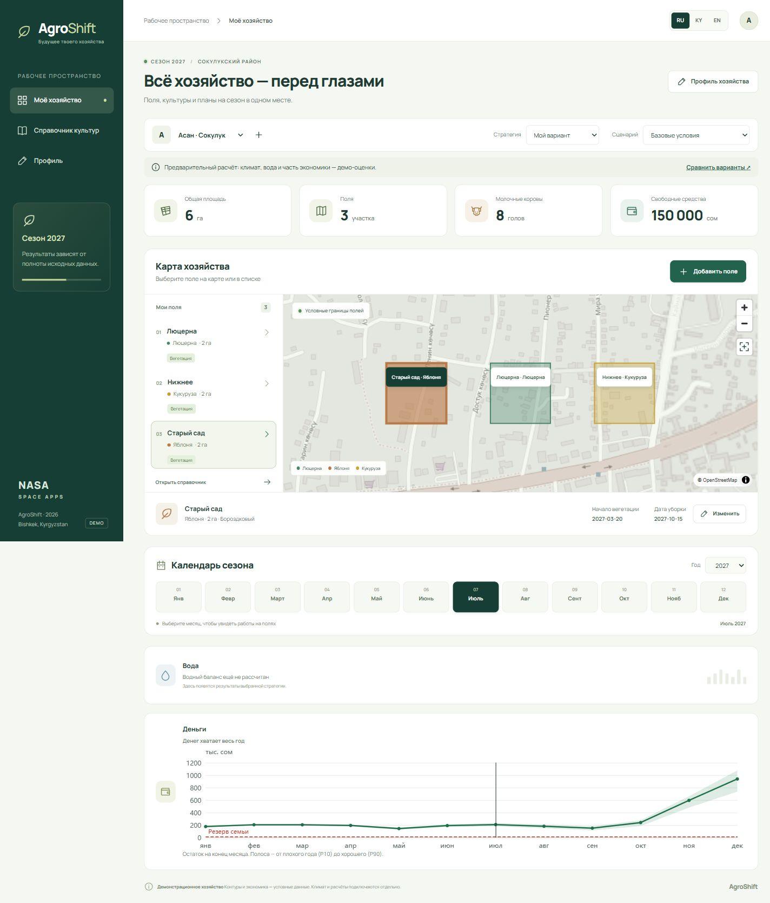

# Баяман — выполнены все 7 задач

Проверено по личному чек-листу «Баяман — хозяйство и справочники» из распределения
задач. Существующая архитектура PostgreSQL/PostGIS + SQLAlchemy сохранена.
Отчёт о данных и источниках первого этапа: [bayaman-phase-1.md](bayaman-phase-1.md).

| № | Задача | Результат |
|---|---|---|
| 1 | Общие Farm, Field, Crop, Scenario; get_farm/get_crop | Типизированные DTO, чтение БД, происхождение и полнота данных |
| 2 | Пять культур | FAO Kc/корни/p/Ky, варианты продукции, цены и месячные затраты с источниками/оценками |
| 3 | Демо «Асан» | Три контура по 2 га, сад на своём поле, 8 коров, очередь, деньги и резерв |
| 4 | Пять сценариев | Исторический 2023, малоснежная зима, вода −20%, корм +40%, оплата +60 дней |
| 5 | CRUD и справочники | Реальные GET/POST/PATCH/DELETE, PostGIS-валидация, пагинация, idempotency, тесты |
| 6 | Главный экран | MapLibre, окраска культур, выбор поля, шкала месяцев/лет, стратегия, сценарии, ленты |
| 7 | Профиль | Создание/редактирование хозяйства, деньги, семейные расходы, коровы, язык, согласия |

Главный экран и формы переведены на RU/KY/EN и адаптированы для телефона. Дополнительно
сделаны формы создания/редактирования полей и просмотр справочников с источниками.

## HTTP API

Префикс `/api/v1`; OpenAPI — `/docs`. Денежные суммы — целые сомы, площадь — га,
координаты — `[долгота, широта]`, WGS84. API хозяйства включён при `DEMO_MODE=true`;
роль `X-Demo-Role` по умолчанию `farmer`, остальные роли получают 403 для профиля.
Это режим хакатона; производственная авторизация остаётся частью общего ядра.

| Метод | Путь | Ответ |
|---|---|---|
| GET | `/farms?limit=50&cursor=<uuid>` | `{items, next_cursor}`, лимит до 100 |
| POST | `/farms` | 201, полное хозяйство |
| GET / PATCH / DELETE | `/farms/{id}` | Хозяйство / хозяйство / 204 |
| GET | `/farms/{id}/fields` | GeoJSON FeatureCollection |
| POST | `/farms/{id}/fields` | 201, поле |
| GET / PATCH / DELETE | `/farms/{id}/fields/{field_id}` | Поле / поле / 204 |
| GET | `/catalog/crops` | Культуры с вариантами, затратами и ценой |
| GET | `/catalog/rotations?zone=chuy` | Экспериментальные схемы и статус агрономической проверки |
| GET | `/scenarios/presets` | Пять готовых сценариев |

POST принимает `Idempotency-Key`: одинаковый запрос возвращает первоначальный
ответ, другое тело с тем же ключом — 409. Запись и ответ фиксируются одной
транзакцией под advisory lock. PATCH сохраняет пропущенные поля, явный `null`
очищает необязательное значение; неизвестное число не подменяется нулём.
Правка сезона сохраняет неуказанную урожайность и проверяет объединённые даты.
Источник неизменённых данных сохраняется, правки записываются в audit log.

Для поля нужны Polygon или Point + площадь. PostGIS проверяет валидность контура,
геодезическую площадь, точку внутри и пересечение полей. Площадь, заданная вместе
с контуром, должна совпадать с расчётом с допуском 0,1%. Записи другого хозяйства
недоступны по вложенному URL; смена культуры сада и его удаление защищены.
Ошибки возвращаются как problem+json с 404/409/422, транзакция откатывается.

## Интеграция экрана и расчётов

`frontend/components/farms/PlanningLanes.tsx` задаёт общий контракт лент.
MoneyLane Абдулазиса подключён через `MoneyIntegration` и конкретный run_id;
результаты другого хозяйства из localStorage не используются.
Адаптер `backend/app/modules/farms/strategy_adapter.py` передаёт расчёту реальные
UUID полей/культур, последний сезон, вариант продукции (силос не становится зерном),
цены, затраты, средства, семейные расходы и количество коров. Ошибка реального
хозяйства больше не заменяется скрыто встроенным демо-хозяйством.

Переключатель показывает варианты, реально вернувшиеся из расчёта. Если одна
схема выиграла по нескольким критериям или не прошла ограничение, это учитывается
модулем стратегий. Выбор меняет карту и денежный график; исходный план сохраняется.
Предложенные культуры не получают выдуманных сроков посева. После правок расчёт
обновляется; результаты последнего сезона не выдаются за план будущего года.

Граница чужих задач обозначена явно: WaterLane и реальные снимки NASA принадлежат
Исламу. Под WaterLane готов слот с пустым состоянием. Вода/климат и часть экономики
в текущем модуле стратегий — оценки, об этом написано на экране. Исторический
сценарий 2023 не запускается на средней погоде. Остальные пресеты корректно
передают отдельный множитель корма, месяцы воды и задержку оплаты.

## Запуск и проверки

```sh
docker compose up --build -d
docker compose exec -T api python -m scripts.seed
docker compose exec -T api ruff check .
docker compose exec -T -e AGROSHIFT_TEST_DB=1 api pytest -q
docker compose exec -T api alembic check
```

Из `frontend`: `npm ci`, `npm run typecheck`, `npm test`, `npm run build`.
CI проверяет backend с настоящим PostGIS и frontend с production-сборкой.
Интеграционные тесты изолированы в случайной схеме с полным откатом данных и DDL.

Проверки 15 ноября 2026:

- 121 backend-тест прошёл, включая CRUD, геометрию, сохранение сезонов, seed и адаптер стратегий.
- 6 frontend-тестов прошли: числа, даты, неизвестные значения, сценарии и предпросмотр.
- TypeScript — без ошибок; `alembic check` — без новых операций миграции.
- Браузер: создание хозяйства/поля, изменение площади и финансов, сохранение после
  перезагрузки, стратегия, календарь, RU/EN/KY, экран 1440 px и телефон 390 px.
- В консоли проверенного главного экрана нет ошибок JavaScript.
- `ruff check .` прошёл. Production-образ успешно собран Docker; frontend, API и БД
  имеют статус healthy. Главная страница и `/api/v1/farms` через proxy работают;
  в локальном запуске frontend доступен на http://localhost:3001 (3000 занят dev-сервером).
- На production-сборке дополнительно проверены сохранение KY после перезагрузки,
  три карточки севооборотов, пустой план 2028 года и выбор поля на карте.
- Созданные при браузерной проверке тестовые хозяйство/поле удалены через API после
  проверки сохранённых значений; в рабочей БД остался исходный Асан.



Исходное предупреждение Starlette о deprecated адаптере httpx не влияет на тесты.
Подробности локальной разработки и контракта лент — [frontend/README.md](../frontend/README.md).
